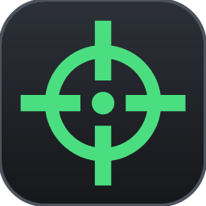
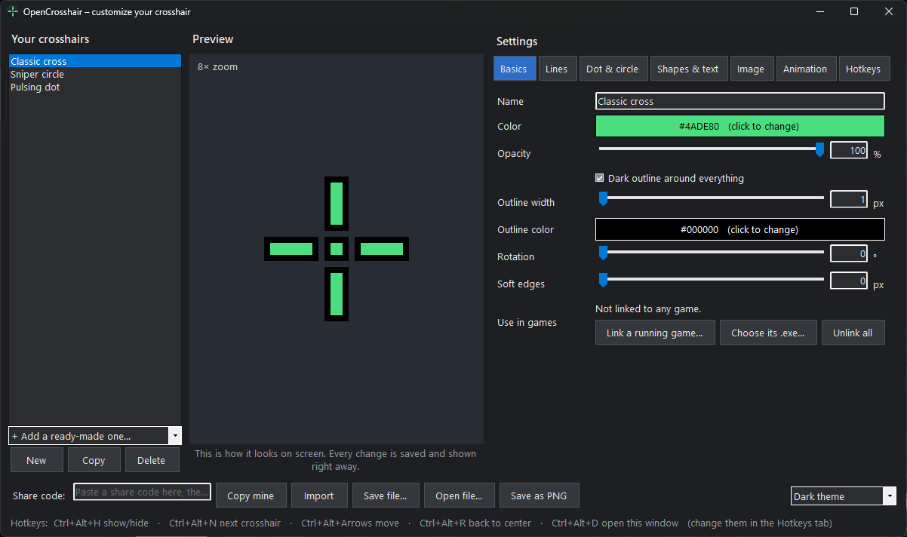
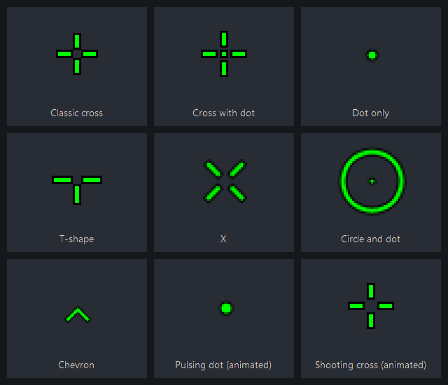
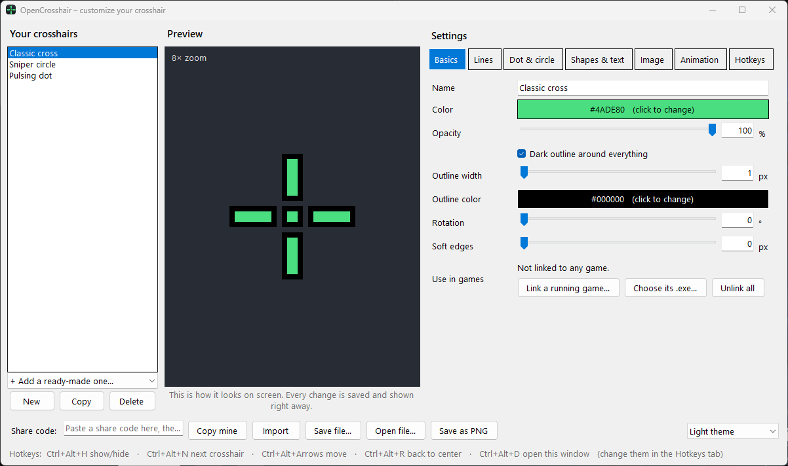

<p align="center">
  
</p>

# OpenCrosshair

A free, open-source crosshair overlay for Windows. It draws a custom crosshair in the middle of your screen, on top
of any game running in **borderless/windowed** mode. No ads, no telemetry, no network access.



## Features

- **Easy customize window** with sliders, color pickers, hover tips, a live animated preview and **ready-made
  crosshairs** to start from:
  - lines: 2 to 8 arms, length, thickness, gap, T-style
  - center dot (square or round), circle or arc, shapes (chevron, triangle, square)
  - a short text label under the crosshair
  - color, opacity, outline, rotation (45° makes an X), soft edges
- **Per-game crosshairs:** link a crosshair to a game and it switches on by itself whenever that game comes to the front
- **Custom images:** use any PNG (transparency works) or **animated GIF** as your crosshair, scaled 10–400 %
- **Animations:**
  - **Shoot:** opens up when you fire (left-click) in a game and eases back
  - **Breathe**, **Blink**, **Rotate**, **Rainbow**, each with a speed setting
- **Unlimited crosshairs:** save as many as you like and switch from the tray menu or with a hotkey
- **Sharing:**
  - **share codes** (`OC2:…`) carry every setting except a picture; codes from 1.0 (`OC1:…`) still import
  - **crosshair files** (`.ochair`) carry everything, picture included
  - **PNG export** of any crosshair
- **Dark mode** (the default), light mode, or match Windows
- **Multi-monitor:** pick the display; nudge the crosshair pixel by pixel, remembered per display
- **Hide while aiming:** optionally hides the crosshair while you hold the right, middle or a side mouse button
- **Global hotkeys** you set in the window, **Start with Windows**, tray icon
- **Stays on top:** jumps back over a game the moment it comes to the front, is click-through, and never takes focus

### Ready-made crosshairs



<details>
<summary>Light theme</summary>


</details>

## Install

Download one file from [Releases](../../releases) and run it. Nothing gets installed.

| File | For |
|---|---|
| `OpenCrosshair.exe` | Most PCs (Windows 10/11, 64-bit). Everything included, about 50 MB. |
| `OpenCrosshair-small.exe` | Same app, about 250 KB, if you have the [.NET 10 Desktop Runtime](https://dotnet.microsoft.com/download/dotnet/10.0). Windows offers to download it if it's missing. |
| `OpenCrosshair-arm64.exe` | Windows on ARM laptops (e.g. Snapdragon). |

The app lives in the system tray (by the clock): double-click the icon to customize, right-click for options.
Tip: put the exe somewhere permanent, start it, then right-click its taskbar button and choose **Pin to taskbar**.
Clicking the pin later opens the customize window.

## Default hotkeys

| Keys | Action |
|---|---|
| `Ctrl+Alt+H` | Show / hide the crosshair |
| `Ctrl+Alt+N` | Next saved crosshair |
| `Ctrl+Alt+D` | Open the customize window |
| `Ctrl+Alt+Arrow keys` | Move the crosshair 1 px |
| `Ctrl+Alt+R` | Back to the exact center |

Change them in the **Hotkeys** tab of the customize window. They use Windows' `RegisterHotKey`, so the app only ever
sees these combinations, never your other keystrokes.

## Settings

Everything is stored in `%APPDATA%\OpenCrosshair\settings.json`. If that file is ever unreadable, it's kept as
`settings.json.bad` and the app starts with defaults instead of overwriting it.

## Limitations

- **Exclusive fullscreen:** Windows doesn't let normal windows draw over exclusive-fullscreen games. Switch the game
  to *borderless* or *windowed fullscreen*.
- **Anti-cheat and game rules:** OpenCrosshair only draws a transparent window on top of your screen. It doesn't read
  or modify game memory or inject anything into games. Some games or tournaments still don't allow crosshair
  overlays, so check the rules of what you play. Use at your own risk.
- **Shoot animation** reacts to left-clicks while a game is in front: one you linked, or any window that fills the
  whole screen. It only checks whether the button is down (no mouse hook) and intercepts nothing.
- **Images:** files up to 25 MB, shrunk to fit 1024 px. Very long or large animated GIFs are cut short (at most
  300 frames, about 128 MB of memory).
- **Labels:** emoji aren't supported.
- **Display scaling above 100 %:** the window is built to scale, but this hasn't been tested on a scaled display yet.
- English only.

See [ROADMAP.md](ROADMAP.md) for what's planned.

## Build from source

Requires the [.NET 10 SDK](https://dotnet.microsoft.com/download) on Windows.

```bash
dotnet test
dotnet run --project src/OpenCrosshair
dotnet publish src/OpenCrosshair -c Release -r win-x64 --self-contained -p:PublishSingleFile=true
```

The icon is drawn by `tools/make-icon.ps1`.

## License

[MIT](LICENSE). OpenCrosshair is an independent project and isn't affiliated with any other crosshair app.
